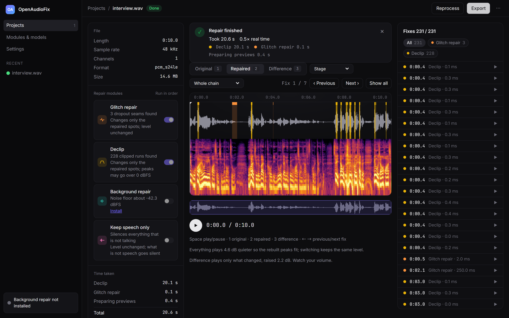
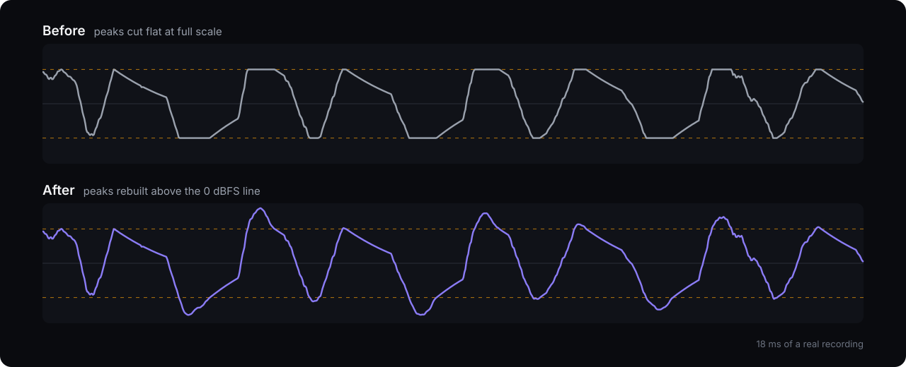
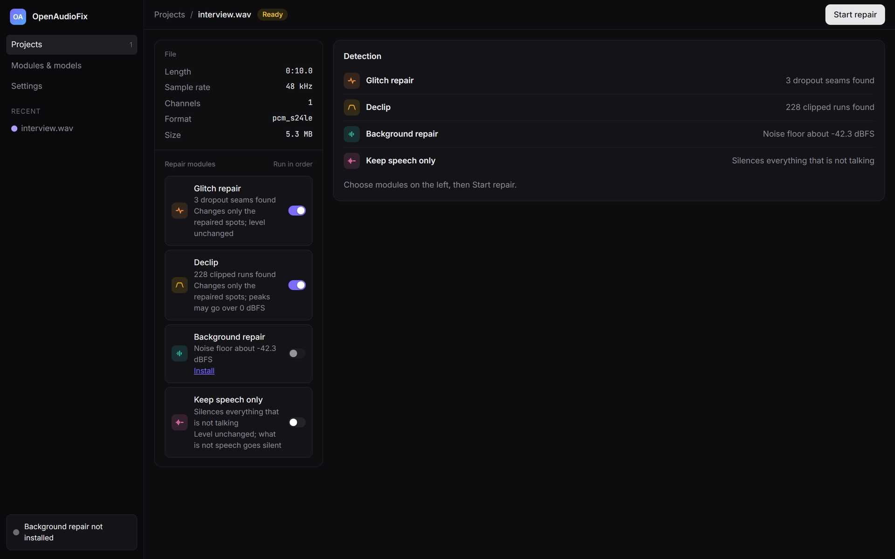
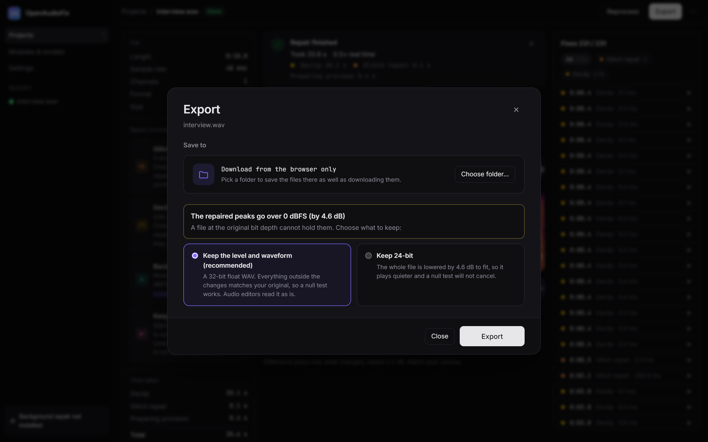

<div align="center">
  
  <h1>OpenAudioFix</h1>
  <p><strong>Repair ruined recordings on your own computer.</strong><br>
  Rebuild clipped peaks, fix dropouts, remove noise and keep only the speech, without touching the rest of your audio.</p>
  <p>
    <a href="https://romanticamaj.github.io/openaudiofix/"><strong>Hear the demo</strong></a> ·
    <a href="#quick-start">Quick start</a> ·
    <a href="docs/how-it-works.md">How it works</a> ·
    <a href="README.zh-TW.md">繁體中文</a>
  </p>
  <p>
    <a href="https://github.com/romanticamaj/openaudiofix/actions/workflows/ci.yml"></a>
    <a href="LICENSE"></a>
    <a href="https://github.com/romanticamaj/openaudiofix/releases"></a>
  </p>
</div>

<a href="https://romanticamaj.github.io/openaudiofix/"></a>

## Why OpenAudioFix

You recorded the perfect take, then found the clipping. Or the ticks from an interface that dropped samples. Most
tools answer by regenerating the whole file. OpenAudioFix fixes the broken samples and leaves the rest alone.

- **Only what is broken changes.** In the demo clip, 94.5% of the samples are exactly as recorded.
- **You can check every fix.** Each repair is listed and marked on the waveform. Switch between the original, each
  step and the difference on the same word.
- **Your audio stays with you.** No account, no upload. It runs on your own machine.



**[Listen to it →](https://romanticamaj.github.io/openaudiofix/)** Ten seconds of a real recording with 228 clipped
peaks and 3 dropouts. Switch between before, after and difference while it plays.

## What it repairs

| Module | Fixes | Needs |
|---|---|---|
| **Declip** | Peaks flattened by too much input gain | CPU |
| **Glitch repair** | Ticks and skips from audio-interface buffer dropouts | CPU |
| **Keep speech only** | Removes knocks, music and silence from a podcast track, and keeps what it removed on a second track | CPU |
| **Background repair** | Noise and room sound, with MossFormer2 | NVIDIA GPU, optional |

## Quick start

Start it with Docker, then open <http://127.0.0.1:8765/>:

```bash
docker run -p 127.0.0.1:8765:8765 -v openaudiofix-data:/data ghcr.io/romanticamaj/openaudiofix:0.1.0
```

Drop in a file, choose the repairs, listen, export. Any format ffmpeg reads is accepted, and export gives you a WAV.

<details>
<summary><strong>With an NVIDIA GPU (adds Background repair)</strong></summary>

You need the NVIDIA driver and the NVIDIA Container Toolkit. The image is about 9 GB because it carries PyTorch and
the model.

```bash
docker run --gpus all -p 127.0.0.1:8765:8765 -v openaudiofix-data:/data ghcr.io/romanticamaj/openaudiofix-gpu:0.1.0
```

Both images use the same data volume, so switching keeps your projects.
</details>

<details>
<summary><strong>Without Docker</strong></summary>

You need Python 3.10 to 3.12, Node.js and ffmpeg on `PATH`.

```bash
git clone https://github.com/romanticamaj/openaudiofix && cd openaudiofix
python -m venv .venv && . .venv/bin/activate      # Windows: .venv\Scripts\activate
pip install -e ".[server]"
cd web && npm ci && npm run build && cd ..
AFIX_WEB_DIST=web/dist python -m server.launcher  # Windows: set AFIX_WEB_DIST=web\dist first
```

Open **Modules & models → Background repair** to install the GPU module from the app (about 6 GB).
</details>

<details>
<summary><strong>Build the images yourself</strong></summary>

```bash
git clone https://github.com/romanticamaj/openaudiofix && cd openaudiofix
docker compose up -d --build
docker compose -f docker-compose.yml -f docker-compose.gpu.yml up -d --build   # GPU version
```
</details>

## Command line

```bash
pip install openaudiofix
afix scan interview.wav                       # report what was found, change nothing
afix repair interview.wav -m glitch,declip    # repaired file, difference file and a CSV of every fix
afix repair interview.wav -m declip --float   # 32-bit float, no gain reduction
afix speech episode.wav                       # episode_speech.wav, episode_removed.wav, episode_removed.txt
afix speech host.wav guest.wav --out-dir edit # tracks of one session are split together
```

You need ffmpeg on `PATH`. `afix --help` lists every option. The web app runs from Docker or a clone.

## Screenshots

<table>
  <tr>
    <td></td>
    <td></td>
  </tr>
  <tr>
    <td align="center">Scan first, then choose what to repair</td>
    <td align="center">Export without overwriting anything</td>
  </tr>
</table>

## How it compares

| | OpenAudioFix | Audacity | iZotope RX | Adobe Podcast |
|---|---|---|---|---|
| Open source | Yes (MIT) | Yes (GPL) | No | No |
| Price | Free | Free | Paid | Free tier, paid plans |
| Audio stays on your computer | Yes | Yes | Yes | No, it is uploaded |
| Lists every change | Yes | No | Partly | No |

RX has far more tools and years of refinement. OpenAudioFix does a few repairs, in the open, and shows its work.

## Good to know

- **Peaks above 0 dBFS are expected.** Rebuilt peaks were above it before the clipping. Export offers a 32-bit float
  file that keeps them, or your original bit depth lowered just enough to fit.
- **Lossy files work**, but repairs are better from WAV or FLAC.
- **It listens on `127.0.0.1` only.** To use your own hostname, set `AFIX_ALLOWED_HOSTS`. See
  [configuration](docs/configuration.md), which also covers folders and environment variables.
- **Unrelated names.** This project has no connection to the iOS and macOS app "AudioFix" or to the npm package `afix`.

## Contributing

Bug reports with a short sample of the audio help most. New repair modules and UI languages are welcome: see
[CONTRIBUTING.md](CONTRIBUTING.md). Every bug that gets fixed gets a test.

## License

[MIT](LICENSE). Third-party components are listed in [THIRD_PARTY.md](THIRD_PARTY.md).
