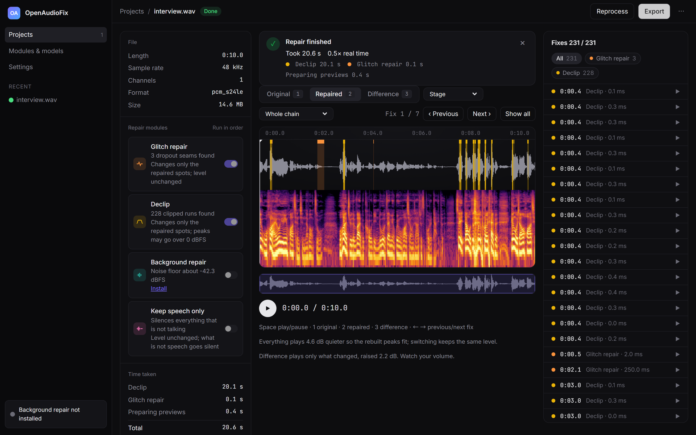
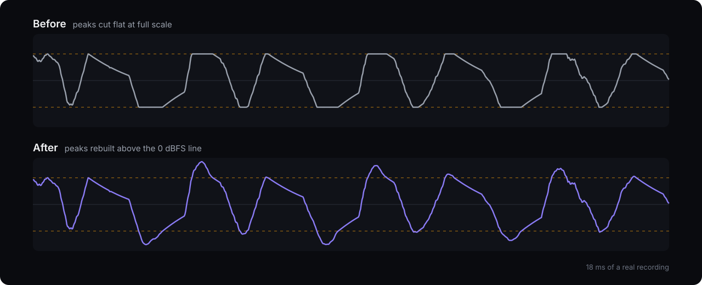

<div align="center">
  
  <h1>OpenAudioFix</h1>
  <p><strong>在自己的電腦上，救回毀掉的錄音。</strong><br>
  重建削波的峰值、修復掉樣本、去除雜音、只留人聲，其他地方的聲音完全不動。</p>
  <p>
    <a href="https://romanticamaj.github.io/openaudiofix/"><strong>試聽示範</strong></a> ·
    <a href="#快速開始">快速開始</a> ·
    <a href="docs/how-it-works.md">運作原理（英文）</a> ·
    <a href="README.md">English</a>
  </p>
</div>

<a href="https://romanticamaj.github.io/openaudiofix/"></a>

## 為什麼用 OpenAudioFix

錄到最好的一段，回頭才發現爆音，或是錄音介面掉樣本留下的噠噠聲。多數工具的做法是把整個檔案重新生成一次。OpenAudioFix 只修壞掉的樣本，其他地方不動。

- **只改壞掉的地方。** 示範片段裡，94.5% 的樣本和原始錄音完全相同。
- **每一處修復都看得到。** 每筆修復都列出來，也標在波形上。同一個字可以在原檔、每個步驟和差異之間切換比對。
- **音檔留在你手上。** 不用帳號，不用上傳，全部在你的電腦上跑。



**[實際聽聽看 →](https://romanticamaj.github.io/openaudiofix/)** 十秒的真實錄音，裡面有 228 處削波和 3 處掉樣本。播放中可以直接切換修復前、修復後和差異。

## 能修什麼

| 模組 | 修復內容 | 需要 |
|---|---|---|
| **削波修復** | 輸入音量過大被切平的峰值 | CPU |
| **Glitch 修復** | 錄音介面緩衝掉樣本造成的噠噠聲和跳音 | CPU |
| **只留人聲** | 去掉 podcast 音軌裡的敲擊、音樂和空白，被去掉的部分另存一軌 | CPU |
| **背景修復** | 用 MossFormer2 去除雜音和空間聲 | NVIDIA GPU，選用 |

## 快速開始

用 Docker 啟動，然後打開 <http://127.0.0.1:8765/>：

```bash
docker run -p 127.0.0.1:8765:8765 -v openaudiofix-data:/data ghcr.io/romanticamaj/openaudiofix:0.1.0
```

丟進檔案，選要修的項目，試聽，匯出。ffmpeg 讀得了的格式都能用，匯出是 WAV。

有 NVIDIA GPU、不用 Docker、命令列的用法，請看[英文版 README](README.md#quick-start)。

## 參與貢獻

回報問題時附上一小段音檔最有幫助。歡迎新增修復模組和介面語言，請看 [CONTRIBUTING.md](CONTRIBUTING.md)。

## 授權

[MIT](LICENSE)。第三方元件列在 [THIRD_PARTY.md](THIRD_PARTY.md)。
